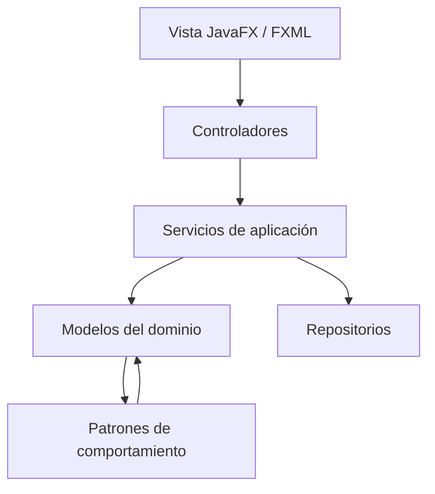

# Hogares Inteligentes

Base inicial para el parcial de Patrones de Diseño. Proyecto Maven para Java 21, JavaFX y FXML, pensado para abrirse directamente en IntelliJ IDEA.

Los nombres de las clases del dominio están en español. Se conservan en inglés los nombres oficiales de los patrones y la interfaz `Command` para que puedan identificarse fácilmente en la sustentación.

## Abrir y ejecutar

1. En IntelliJ IDEA, selecciona **Open** y elige la carpeta `hogares_inteligentes` (o su archivo `pom.xml`).
2. Acepta la importación como proyecto Maven y espera a que IntelliJ descargue JavaFX.
3. Verifica que el proyecto use un JDK 21.
4. Ejecuta `AplicacionHogar` o la tarea Maven `javafx:run`.

## Alcance implementado en esta base

- Arranque JavaFX y una pantalla FXML mínima con acciones para encender y apagar una luz.
- Modelo `Dispositivo` / `Luz` con identificador, nombre, habitación y estado.
- `State`: `Luz` delega encendido/apagado a estados concretos `EstadoEncendido` y `EstadoApagado`.
- `Observer`: `ObservadorDispositivo` recibe cambios; `ControladorHogar` actualiza la vista.
- `Command`: `ComandoCambiarEstadoLuz` ejecuta y deshace una acción sobre la luz; implementa la interfaz `Command`.
- `Strategy`: `EstrategiaAutomatizacion` define qué hacer al detectar movimiento.
- `Mediator`: `MediadorHogar` coordina la estrategia y la luz de una habitación.
- Adicionales iniciados: `Factory Method` (`CreadorDispositivo` / `CreadorLuz`), `Adapter` para normalizar la lectura de un sensor legado y `Composite` (`GrupoDispositivos`) para tratar grupos como dispositivos.

Esta es una base de trabajo; algunos patrones adicionales solo tienen su primer esqueleto y deben conectarse a flujos reales antes de presentarlos como terminados.

## Diagrama de arquitectura



## Árbol de paquetes

```text
co.edu.smarthome
├── app          Inicio de JavaFX
├── controller   Controladores de la interfaz
├── model
│   ├── device   `Dispositivo` y `Luz`
│   ├── event    Eventos del dominio (pendiente)
│   └── state    `EstadoDispositivo`, `EstadoEncendido`, `EstadoApagado` (State)
├── observer     `ObservadorDispositivo` (Observer)
├── command      `Command` y `ComandoCambiarEstadoLuz` (Command)
├── strategy     `EstrategiaAutomatizacion` (Strategy)
├── mediator     `MediadorHogar` (Mediator)
├── factory      `CreadorDispositivo`, `CreadorLuz` (Factory Method)
├── adapter      `SensorMovimiento`, `AdaptadorSensorMovimiento` (Adapter)
├── composite    `GrupoDispositivos` (Composite)
├── service      Casos de uso (pendiente de ampliar)
└── repository   Persistencia (pendiente)
```

## Reparto para continuar con el equipo

### Ya queda como punto de partida

- Estructura Maven y paquetes base.
- Flujo pequeño de luz: vista FXML → controlador → modelo → notificación Observer → actualización de la vista.
- Clases iniciales de Command, Strategy, Mediator y patrones adicionales para extender.
- Diagrama, árbol de paquetes y estas instrucciones de ejecución.

### Siguiente trabajo para el equipo

1. **Integrante A — interfaz:** mejorar FXML/CSS y crear vistas para listar, crear y controlar dispositivos.
2. **Integrante B — dominio y automatización:** agregar `SensorMovimiento`, conectar eventos de movimiento con `MediadorHogar` y estrategias seleccionables.
3. **Integrante C — acciones y grupos:** agregar historial/deshacer de comandos y operaciones grupales reales con Composite.
4. **Integrante D — persistencia y entrega:** implementar repositorio, documentación final, capturas/demo y preparar el video de presentación.

Si son menos integrantes, pueden combinar los bloques. Antes de entregar deben verificar que cada patrón participa en una funcionalidad observable y justificar su uso en el README y el video.

## Patrones del parcial

Obligatorios: Observer, Strategy, Command, State y Mediator. Selección adicional propuesta: Factory Method (creacional, peso 2), Adapter (estructural, peso 2) y Composite (estructural, peso 3); suma de complejidad: 7. La rúbrica evalúa implementación e integración, así que los adicionales deben terminarse y demostrarse en funcionalidades reales.
