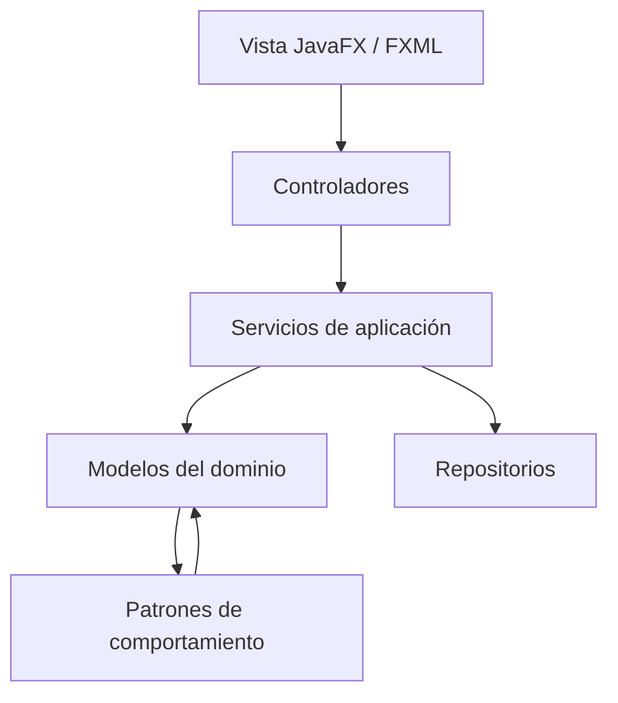

# Hogares Inteligentes

Base inicial para el parcial de Patrones de Diseño. Proyecto Maven para Java 21, JavaFX y FXML, pensado para abrirse directamente en IntelliJ IDEA.


## Abrir y ejecutar

1. En IntelliJ IDEA, selecciona **Open** y elige la carpeta `hogares_inteligentes` (o su archivo `pom.xml`).
2. Acepta la importación como proyecto Maven y espera a que IntelliJ descargue JavaFX.
3. Verifica que el proyecto use un JDK 21.
4. Ejecuta `AplicacionHogar` o la tarea Maven `javafx:run`.

## Alcance implementado en esta base

- Arranque JavaFX y una pantalla FXML mínima con acciones para encender y apagar una luz.
- Modelo `Dispositivo` / `Luz` con identificador, nombre, habitación y estado.
- `State`: `Luz` delega encendido/apagado a estados concretos `EstadoEncendido` y `EstadoApagado`.
- `Observer`: `ObservadorDispositivo` recibe cambios; `ControladorHogar` actualiza la vista.
- `Command`: `ComandoCambiarEstadoLuz` ejecuta y deshace una acción sobre la luz; implementa la interfaz `Command`.
- `Strategy`: `EstrategiaAutomatizacion` define qué hacer al detectar movimiento.
- `Mediator`: `MediadorHogar` coordina la estrategia y la luz de una habitación.
- Adicionales iniciados: `Factory Method` (`CreadorDispositivo` / `CreadorLuz`), `Adapter` para normalizar la lectura de un sensor legado y `Composite` (`GrupoDispositivos`) para tratar grupos como dispositivos.

Esta es una base de trabajo; algunos patrones adicionales solo tienen su primer esqueleto y deben conectarse a flujos reales.

## Diagrama de arquitectura



## Árbol de paquetes

```text
co.edu.smarthome
├── app          Inicio de JavaFX
├── controller   Controladores de la interfaz
├── model
│   ├── device   `Dispositivo` y `Luz`
│   ├── event    Eventos del dominio (pendiente)
│   └── state    `EstadoDispositivo`, `EstadoEncendido`, `EstadoApagado` (State)
├── observer     `ObservadorDispositivo` (Observer)
├── command      `Command` y `ComandoCambiarEstadoLuz` (Command)
├── strategy     `EstrategiaAutomatizacion` (Strategy)
├── mediator     `MediadorHogar` (Mediator)
├── factory      `CreadorDispositivo`, `CreadorLuz` (Factory Method)
├── adapter      `SensorMovimiento`, `AdaptadorSensorMovimiento` (Adapter)
├── composite    `GrupoDispositivos` (Composite)
├── service      Casos de uso (pendiente de ampliar)
└── repository   Persistencia (pendiente)
```

## Qué hicimos nosotros y por dónde sigue el equipo

La idea de esta primera parte es dejar armado el esqueleto y un ejemplo pequeño que sí se pueda ejecutar. Así todos pueden abrir el proyecto, entender cómo se conectan las capas y continuar sobre los mismos paquetes. No estamos diciendo que el sistema completo ya esté terminado.

### Lo que ya dejamos andando o preparado

- Dejamos Maven, JavaFX, el árbol de paquetes, el diagrama y una guía para abrirlo en IntelliJ.
- La pantalla de `vista-hogar.fxml` permite encender y apagar una luz. El recorrido es vista → `ControladorHogar` → `Luz`; cuando cambia el estado, `ObservadorDispositivo` avisa para actualizar la pantalla. Ese es el ejemplo que podemos usar para guiarnos.
- `Luz`, `EstadoDispositivo`, `EstadoEncendido` y `EstadoApagado` ya muestran el patrón State.
- `Command` y `ComandoCambiarEstadoLuz` ya tienen una acción para cambiar la luz y deshacerla. Falta conectarlos a botones y guardar un historial de acciones.
- `EstrategiaAutomatizacion` y `EstrategiaEncenderLuzPorMovimiento` dejan lista una regla de automatización. Falta conectarla a la lectura de un sensor y permitir escoger reglas.
- `MediadorHogar` está como punto de coordinación; falta integrarlo al flujo completo del sensor, las reglas y los dispositivos.
- `CreadorDispositivo` / `CreadorLuz`, `SensorMovimiento` / `AdaptadorSensorMovimiento` y `GrupoDispositivos` ya tienen clases iniciales para Factory Method, Adapter y Composite. Hay que completar y demostrar esos patrones con funciones reales.
- Los paquetes `service`, `repository` y `model.event` quedan como espacio para agregar casos de uso, persistencia y eventos cuando el equipo los necesite.

### Reparto sugerido para seguir

1. **Interfaz:** continuar desde `vista-hogar.fxml` y `ControladorHogar`; agregar pantallas para listar, crear y controlar varios dispositivos.
2. **Sensores y automatización:** completar `SensorMovimientoAntiguo` y `AdaptadorSensorMovimiento`, definir los eventos que hagan falta y conectar el sensor con `EstrategiaEncenderLuzPorMovimiento` y `MediadorHogar`.
3. **Comandos y grupos:** conectar `ComandoCambiarEstadoLuz` a la interfaz, agregar historial/deshacer y completar `GrupoDispositivos` para operar varios dispositivos juntos.
4. **Persistencia y entrega:** definir el repositorio que necesite el proyecto, guardar y recuperar dispositivos, y apoyar la documentación, la demo y el video.

Nos podemos repartir estos bloques según cuántos seamos y luego integrar el trabajo en las mismas clases y paquetes. Antes de entregar, revisemos juntos que cada patrón obligatorio y los adicionales aparezcan en una función que se pueda mostrar, porque tener la clase creada por sí sola no significa que el patrón ya esté integrado.

## Patrones del parcial

Obligatorios: Observer, Strategy, Command, State y Mediator. Selección adicional propuesta: Factory Method (creacional, peso 2), Adapter (estructural, peso 2) y Composite (estructural, peso 3); suma de complejidad: 7. La rúbrica evalúa implementación e integración, así que los adicionales deben terminarse y demostrarse en funcionalidades reales.

