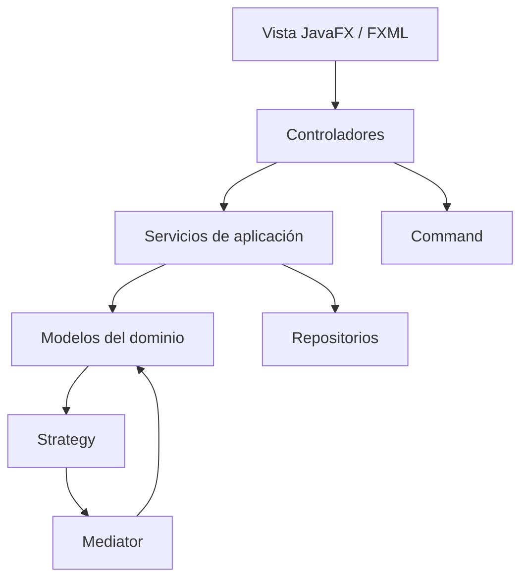

# Hogares Inteligentes

Base inicial para el parcial de Patrones de Diseño. Proyecto Maven para Java 21, JavaFX y FXML, pensado para abrirse directamente en IntelliJ IDEA.

## Abrir y ejecutar

1. En IntelliJ IDEA, selecciona **Open** y elige la carpeta `hogares_inteligentes` (o su archivo `pom.xml`).
2. Acepta la importación como proyecto Maven y espera a que IntelliJ descargue JavaFX.
3. Verifica que el proyecto use un JDK 21.
4. Ejecuta `AplicacionHogar` o la tarea Maven `javafx:run`.

## Qué queda en esta base

- Arranque JavaFX y una pantalla FXML mínima con acciones para encender y apagar una luz.
- Modelo `Dispositivo` / `Luz` con identificador, nombre, habitación y estado.
- `State`: `Luz` delega encendido/apagado a estados concretos `EstadoEncendido` y `EstadoApagado`.
- `Observer`: `ObservadorDispositivo` recibe cambios; `ControladorHogar` actualiza la vista.
- `Command`: `ComandoCambiarEstadoLuz`, `ComandoAjustarTemperatura` y `ComandoCambiarCerradura` implementan acciones reversibles; `InvocadorComandos` mantiene una pila. Falta conectarlos a la interfaz.
- `Strategy` y `Mediator`: ya funcionan en la pantalla principal. Se puede elegir entre `EstrategiaEncenderLuzPorMovimiento` (enciende y la deja encendida) y `EstrategiaSeguirMovimiento` (enciende con movimiento y apaga cuando la habitación queda vacía). `MediadorHogar` recibe la lectura del sensor adaptado, busca las luces y reglas activas de esa habitación y aplica la estrategia.
- `Factory Method`: `CreadorLuz`, `CreadorTermostato` y `CreadorCerradura` crean los dispositivos elegidos para esta base.
- `Adapter`: `AdaptadorSensorMovimiento` adapta la lectura del sensor simulado al contrato que consume el mediador. Para la entrega falta reemplazar el simulador por una fuente real, si el grupo va a usar hardware.
- `Composite`: `GrupoDispositivos` agrupa dispositivos; falta completar y conectar acciones grupales.
- El modelo ya contempla hogar, habitaciones, luz, termostato, cerradura, reglas y eventos. Los servicios CRUD y repositorios en memoria permiten continuar sin decidir todavía una base de datos.
- Dejamos controladores y vistas FXML para dispositivos, automatizaciones e historial como sitios concretos para que el equipo conecte las funciones.

La pantalla principal también permite probar las dos estrategias con lecturas simuladas de movimiento y ausencia. El sensor pasa por `AdaptadorSensorMovimiento`, y el mediador coordina la regla y la luz de la sala. Las demás piezas siguen siendo contratos o esqueletos; no contemos un patrón como terminado hasta integrarlo en una función que se pueda demostrar.

## Diagrama de arquitectura



## Paquetes y clases principales

```text
co.edu.smarthome
├── app          Inicio de JavaFX
├── controller   ControladorHogar, ControladorDispositivos,
│                ControladorAutomatizaciones, ControladorHistorial
├── model
│   ├── home     `Hogar`, `Habitacion`
│   ├── device   `Dispositivo`, `Luz`, `Termostato`, `CerraduraInteligente`
│   ├── automation `ReglaAutomatizacion`
│   ├── event    `EventoHogar`, `TipoEventoHogar`
│   └── state    `EstadoDispositivo`, `EstadoEncendido`, `EstadoApagado` (State)
├── observer     `ObservadorDispositivo`, `ObservadorEventosHogar` (Observer)
├── command      `Command`, comandos de luz/termostato/cerradura, `InvocadorComandos`
├── strategy     `EstrategiaAutomatizacion`, `EstrategiaEncenderLuzPorMovimiento`,
│                `EstrategiaSeguirMovimiento`
├── mediator     `MediadorHogar` (Mediator)
├── factory      Creadores de luz, termostato y cerradura (Factory Method)
├── adapter      `SensorMovimiento`, `AdaptadorSensorMovimiento` (Adapter)
├── composite    `GrupoDispositivos` (Composite)
├── service      Servicios de hogares, dispositivos, automatizaciones e historial
└── repository   Contratos y repositorios temporales en memoria
```

## Que se hizo
La idea de esta primera parte es dejar los paquetes y las clases que ya acordamos para el alcance, más un ejemplo pequeño que sí se puede ejecutar. Así todos pueden abrir el proyecto, repartirse esos archivos y continuar sobre la misma estructura. No estamos diciendo que el sistema completo ya esté terminado.

### Lo que ya dejamos andando o preparado

- Dejamos Maven, JavaFX, el árbol de paquetes, el diagrama y una guía para abrirlo en IntelliJ.
- La pantalla de `vista-hogar.fxml` permite encender y apagar una luz. El recorrido es vista → `ControladorHogar` → `Luz`; cuando cambia el estado, `ObservadorDispositivo` avisa para actualizar la pantalla. Ese es el ejemplo que podemos usar para guiarnos.
- `Luz`, `EstadoDispositivo`, `EstadoEncendido` y `EstadoApagado` ya muestran el patrón State.
- También dejamos modelos para `Hogar`, `Habitacion`, `Termostato`, `CerraduraInteligente`, `ReglaAutomatizacion` y eventos del dominio.
- `ServicioDispositivos`, `ServicioHogares`, `ServicioAutomatizaciones` y `ServicioHistorial` ya se apoyan en sus interfaces de repositorio; las implementaciones actuales guardan datos en memoria, no en disco.
- Dejamos controladores y FXML de dispositivos, automatizaciones e historial. Sus botones muestran los puntos pendientes para que el equipo conecte las funciones.
- Las clases de patrones ya están organizadas. La pantalla principal solo demuestra el flujo completo de la luz; los patrones que faltan deben conectarse antes de darlos por terminados.

### Reparto sugerido para seguir

1. **Pantallas:** completar `ControladorDispositivos`, `ControladorAutomatizaciones` y `ControladorHistorial`, sus vistas FXML y la navegación desde `ControladorHogar`.
2. **Hogar y dispositivos:** conectar `Hogar` / `Habitacion` con `ServicioHogares` y `ServicioDispositivos`; terminar formularios y acciones para luz, termostato y cerradura. Aquí también se pueden ampliar los creadores Factory Method.
3. **Automatización y sensores:** reemplazar el sensor simulado por una fuente real, si se va a usar; permitir crear y guardar varias reglas y habitaciones desde `ServicioAutomatizaciones`, y conectarlas a sus dispositivos.
4. **Acciones, grupos e historial:** conectar `InvocadorComandos` a la interfaz, completar acciones de `GrupoDispositivos` y mostrar eventos con `ServicioHistorial`.
5. **Integración y entrega:** acordar si se necesita guardar en archivo o base de datos, sustituir los repositorios en memoria si hace falta y preparar documentación, demo y video.

Nos podemos repartir estos bloques según cuántos seamos y luego integrar el trabajo en las mismas clases y paquetes. El enunciado deja que cada grupo defina las funciones; esta es la propuesta de alcance que armamos nosotros. Antes de entregar, revisemos juntos que cada patrón obligatorio y los adicionales aparezcan en una función que se pueda mostrar, porque tener la clase creada por sí sola no significa que el patrón ya esté integrado.

## Patrones del parcial

Obligatorios: Observer, Strategy, Command, State y Mediator. Selección adicional propuesta: Factory Method (creacional, peso 2), Adapter (estructural, peso 2) y Composite (estructural, peso 3); suma de complejidad: 7. Strategy y Mediator ya se demuestran con el sensor simulado y la luz de la sala; los demás patrones deben conectarse a sus flujos reales antes de la entrega.
