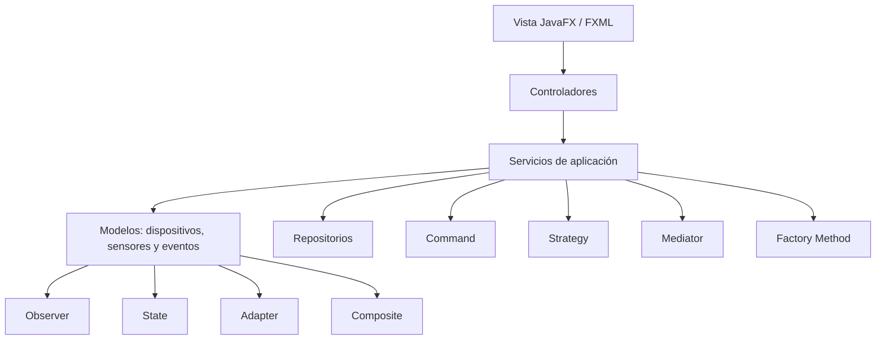

# Arquitectura inicial

## Decisión de capas

La interfaz JavaFX/FXML solo presenta información y recoge acciones. Los controladores delegan en servicios de aplicación. Los servicios coordinan modelos, comandos, estrategias y repositorios. Los modelos representan dispositivos y sus estados; no dependen de JavaFX.

## Primer flujo funcional

`vista-hogar.fxml` → `ControladorHogar` → `Luz.encender()` / `apagar()` → `EstadoDispositivo` cambia el estado → `ObservadorDispositivo` notifica al controlador → etiquetas de la pantalla se actualizan.

## Límites de esta entrega

La pantalla solo demuestra una luz. Aún no hay sensores reales, persistencia, catálogo de dispositivos, selector de estrategias, historial de comandos ni operaciones de grupo. Esos son puntos definidos para continuar en equipo.
