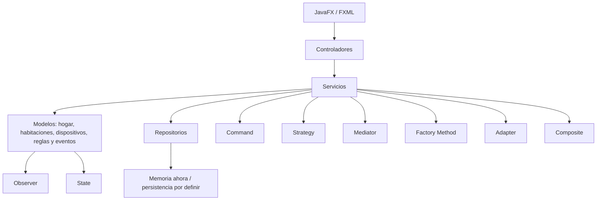

# Arquitectura base del proyecto

Esta organización deja puestos los lugares donde vamos a trabajar. Solo el flujo de la luz está conectado de principio a fin; los demás controladores y vistas muestran dónde continuar. Las interfaces de repositorio y sus versiones en memoria sirven como base para que el equipo agregue la persistencia que decida.

## Capas



## Paquetes y clases

```text
co.edu.smarthome
├── app                 AplicacionHogar
├── controller          ControladorHogar, ControladorDispositivos,
│                       ControladorAutomatizaciones, ControladorHistorial
├── model
│   ├── home            Hogar, Habitacion
│   ├── device          Dispositivo, Luz, Termostato, CerraduraInteligente
│   ├── automation      ReglaAutomatizacion
│   ├── event           EventoHogar, TipoEventoHogar
│   └── state           ContextoLuz, EstadoDispositivo,
│                       EstadoEncendido, EstadoApagado
├── observer            ObservadorDispositivo, ObservadorEventosHogar
├── command             Command, ComandoCambiarEstadoLuz, InvocadorComandos
├── strategy            EstrategiaAutomatizacion,
│                       EstrategiaEncenderLuzPorMovimiento
├── mediator             MediadorHogar
├── factory              CreadorDispositivo, CreadorLuz,
│                       CreadorTermostato, CreadorCerradura
├── adapter              SensorMovimiento, SensorMovimientoAntiguo,
│                       AdaptadorSensorMovimiento
├── composite             GrupoDispositivos
├── service               ServicioDispositivos, ServicioHogares,
│                       ServicioAutomatizaciones, ServicioHistorial
└── repository            RepositorioDispositivos, RepositorioHogares,
                        RepositorioReglas, RepositorioEventos
    └── memory            RepositorioDispositivosMemoria,
                        RepositorioHogaresMemoria, RepositorioReglasMemoria,
                        RepositorioEventosMemoria
```

## Flujos que ya se pueden ejecutar

`vista-hogar.fxml` → `ControladorHogar` → `Luz` → `EstadoApagado` / `EstadoEncendido` → `ObservadorDispositivo` → actualización de la pantalla.

`vista-hogar.fxml` → `ControladorHogar` → `AdaptadorSensorMovimiento` → `MediadorHogar` → regla activa de la sala → estrategia elegida → cambio del estado de `Luz` → Observer actualiza la pantalla.

## Pendiente de integración

- Las pantallas de dispositivos, automatizaciones e historial son puntos de partida: conectar sus controladores con los servicios y completar las acciones.
- Registrar los dispositivos creados en `ServicioDispositivos` y asignarlos a `Habitacion` y `Hogar`.
- Reemplazar el sensor simulado por una fuente real, si el grupo va a usar hardware, y administrar varias reglas desde `ServicioAutomatizaciones`.
- Usar `InvocadorComandos` desde la interfaz para ejecutar y deshacer acciones; ampliar los comandos cuando existan más dispositivos.
- Completar operaciones sobre todos los miembros de `GrupoDispositivos`.
- Cambiar los repositorios en memoria por la persistencia que acuerde el grupo, si el alcance lo requiere.

Los patrones solo se pueden presentar como implementados cuando participen en esos flujos; que exista una clase con el nombre del patrón no alcanza para la evaluación.
