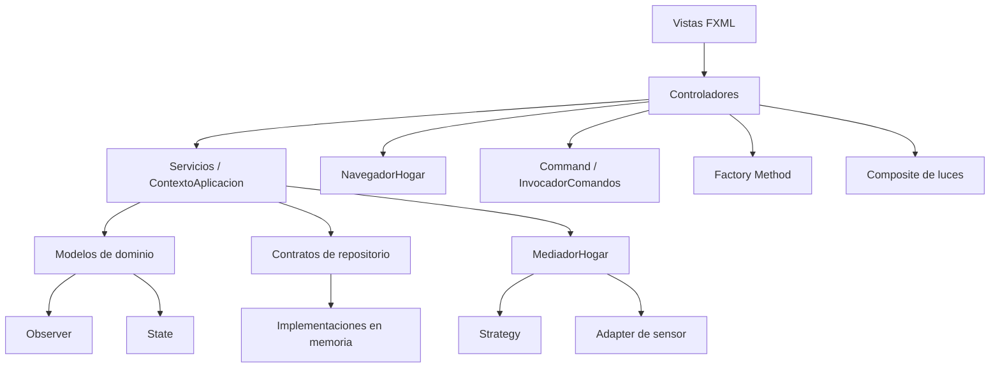

# Arquitectura y guía del código

## Propósito

Aplicación de escritorio para administrar dispositivos de un hogar inteligente, definir automatizaciones por habitación y consultar la actividad reciente. La interfaz usa JavaFX y FXML; Maven administra la compilación y las dependencias. La aplicación inicia en `co.edu.smarthome.app.AplicacionHogar`.

## Organización del código

| Paquete | Responsabilidad | Clases principales |
|---|---|---|
| `app` | Arranque de JavaFX y composición inicial | `AplicacionHogar` |
| `controller` | Acciones de interfaz, navegación y ciclo de vida de vistas | `ControladorHogar`, `ControladorDispositivos`, `ControladorAutomatizaciones`, `ControladorHistorial`, `NavegadorHogar` |
| `model.home` | Hogares, habitaciones y agrupación de dispositivos | `Hogar`, `Habitacion` |
| `model.device` | Dispositivos y contratos de control | `Dispositivo`, `Luz`, `Termostato`, `CerraduraInteligente`, `DispositivoControlable` |
| `model.state` | Estados de la luz | `ContextoLuz`, `EstadoDispositivo`, `EstadoEncendido`, `EstadoApagado` |
| `model.automation` | Reglas configurables | `ReglaAutomatizacion` |
| `model.event` | Tipos y datos de actividad | `EventoHogar`, `TipoEventoHogar` |
| `service` | Casos de uso y ensamblaje de dependencias | `ContextoAplicacion`, `ServicioDispositivos`, `ServicioHogares`, `ServicioAutomatizaciones`, `ServicioHistorial` |
| `repository` | Contratos de almacenamiento | `RepositorioDispositivos`, `RepositorioHogares`, `RepositorioReglas`, `RepositorioEventos` |
| `repository.memory` | Almacenamiento temporal en memoria | Implementaciones `Repositorio*Memoria` |
| `command` | Acciones ejecutables y reversibles | `Command`, comandos concretos, `InvocadorComandos` |
| `observer` | Contratos de notificación de cambios y eventos | `ObservadorDispositivo`, `ObservadorEventosHogar` |
| `strategy` | Políticas de respuesta ante movimiento | `EstrategiaAutomatizacion` y estrategias concretas |
| `mediator` | Coordinación entre sensor, reglas y luces | `MediadorHogar` |
| `factory` | Creación desacoplada de dispositivos | `CreadorDispositivo` y creadores concretos |
| `adapter` | Normalización de la lectura del sensor | `SensorMovimiento`, `SensorMovimientoAntiguo`, `AdaptadorSensorMovimiento` |
| `composite` | Operación conjunta de luces seleccionadas | `GrupoDispositivos` |

## Dependencias y flujo

`AplicacionHogar` crea el `ContextoAplicacion` y el navegador. El contexto comparte servicios, repositorios en memoria, el mediador y el invocador de comandos. Los controladores solicitan operaciones a esos componentes y actualizan las vistas.

## Flujos principales

- **Luz y estado:** `ControladorHogar` acciona `Luz`; la luz delega en `EstadoEncendido` o `EstadoApagado` y notifica a `ObservadorDispositivo` al cambiar.
- **Automatización:** el sensor simulado entrega una lectura numérica; `AdaptadorSensorMovimiento` la convierte a booleano; `MediadorHogar` busca la regla activa de la habitación y ejecuta su `EstrategiaAutomatizacion`.
- **Reglas:** el mediador permite como máximo una regla activa por habitación. Registrar una regla nueva no desplaza la activa; activar otra desactiva la anterior en esa habitación.
- **Comandos:** `InvocadorComandos` ejecuta acciones encapsuladas y conserva el historial necesario para deshacer la última.
- **Grupos:** `GrupoDispositivos` implementa `DispositivoControlable` y aplica encendido o apagado a sus miembros seleccionados.
- **Eventos:** `ContextoAplicacion` registra eventos en `ServicioHistorial`; la pantalla de historial se suscribe mientras está visible y se desuscribe al ocultarse.

## Persistencia y límites actuales

Los repositorios concretos guardan datos en memoria: hogares, dispositivos, reglas y eventos se pierden al cerrar el proceso. El sensor de movimiento es simulado y no requiere hardware. Las interfaces de repositorio permiten sustituir el almacenamiento si el alcance futuro lo necesita.

## Ejecutar

Abre el proyecto o `pom.xml` en IntelliJ IDEA, configura JDK 21 e importa Maven. Ejecuta `co.edu.smarthome.app.AplicacionHogar` o usa `mvn javafx:run` desde la raíz del proyecto.
